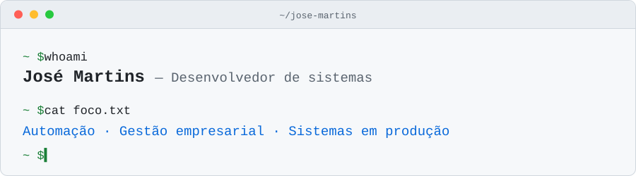
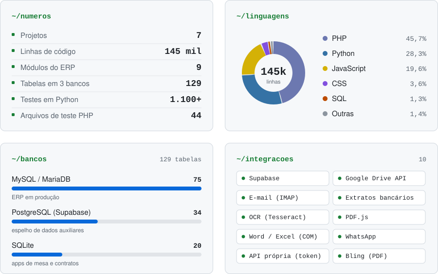

  <picture>
    <source media="(prefers-color-scheme: dark)" srcset="assets/banner-dark.svg">
    
  </picture>

  <a href="https://www.linkedin.com/in/jos3martins/">LinkedIn</a> &nbsp;·&nbsp;
  <a href="mailto:netojosemartins61@gmail.com">E-mail</a> &nbsp;·&nbsp;
  <a href="https://n33to.github.io">Hub de contribuições</a>

  <picture><source media="(prefers-color-scheme: dark)" srcset="https://skillicons.dev/icons?i=php&theme=dark"></picture>&nbsp;&nbsp;
  <picture><source media="(prefers-color-scheme: dark)" srcset="https://skillicons.dev/icons?i=py&theme=dark"></picture>&nbsp;&nbsp;
  <picture><source media="(prefers-color-scheme: dark)" srcset="https://skillicons.dev/icons?i=js&theme=dark"></picture>&nbsp;&nbsp;
  <picture><source media="(prefers-color-scheme: dark)" srcset="https://skillicons.dev/icons?i=html&theme=dark"></picture>&nbsp;&nbsp;
  <picture><source media="(prefers-color-scheme: dark)" srcset="https://skillicons.dev/icons?i=css&theme=dark"></picture>&nbsp;&nbsp;
  <picture><source media="(prefers-color-scheme: dark)" srcset="https://skillicons.dev/icons?i=mysql&theme=dark"></picture>&nbsp;&nbsp;
  <picture><source media="(prefers-color-scheme: dark)" srcset="https://skillicons.dev/icons?i=supabase&theme=dark"></picture>&nbsp;&nbsp;
  <picture><source media="(prefers-color-scheme: dark)" srcset="https://skillicons.dev/icons?i=git&theme=dark"></picture>
   
  também: MariaDB · SQLite · Excel · VBA

## `~/metricas`

  <picture>
    <source media="(prefers-color-scheme: dark)" srcset="assets/metricas-dark.svg">
    
  </picture>

Medido nos meus projetos, sem contar bibliotecas de terceiros. O código não é público; a arquitetura de cada um está nos repositórios abaixo.

## `~/projeto-principal`

### ERP de gestão · em produção

Sistema web multiusuário, construído do zero para uma empresa de construção civil.

| Problema | Solução |
|---|---|
| Pessoal, ponto, financeiro e documentos espalhados em planilhas e em três programas | Um site único: ponto, financeiro, documentos e obras, com permissões por perfil e auditoria |

`9 módulos` &nbsp; `75 tabelas` &nbsp; `~87 mil linhas` &nbsp; `44 arquivos de teste`

`PHP 8.2+` &nbsp; `MySQL` &nbsp; `JavaScript` &nbsp; `HTML` &nbsp; `CSS`

**[Ver arquitetura e esquema do banco →](https://github.com/N33to/erp-gestao-empresarial)**

## `~/outros-projetos`

| Projeto | O que faz |
|---|---|
| [Scanner de documentos de RH](https://github.com/N33to/scanner-documentos-rh) | Separa e nomeia PDFs com OCR local · Python |
| [Gerador de contratos](https://github.com/N33to/gerador-contratos) | Proposta em PDF vira contrato em Word · PHP |
| [DP Web](https://github.com/N33to/dp-documentos-web) | Dossiê de documentos por colaborador e obra · PHP, Python |
| [Apps de mesa](https://github.com/N33to/apps-desktop-python) | Financeiro e ponto com horas extras · Python |

## `~/contato`

**Vamos conversar.** 
[LinkedIn](https://www.linkedin.com/in/jos3martins/) &nbsp;·&nbsp; [netojosemartins61@gmail.com](mailto:netojosemartins61@gmail.com) &nbsp;·&nbsp; [GitHub](https://github.com/N33to)
